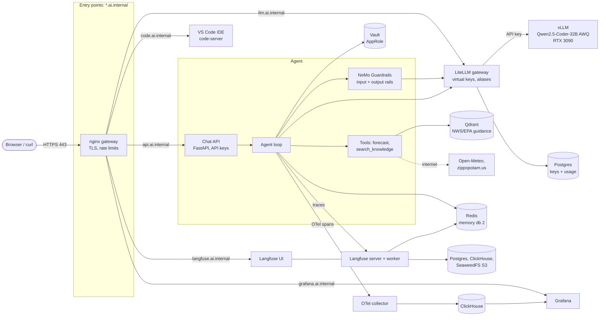
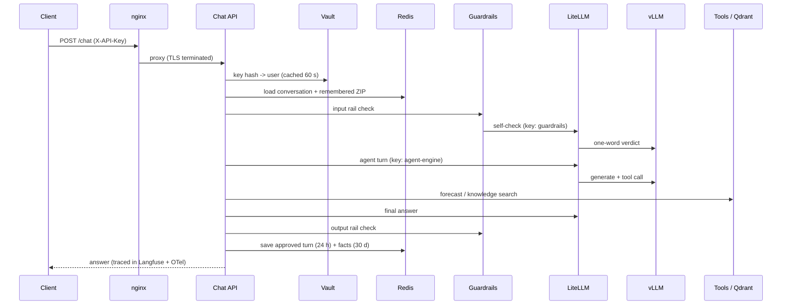

# Enterprise AI Stack

An enterprise-style reference architecture for a **guarded, observable LLM agent**, running
fully locally on a single consumer GPU (RTX 3090). Nineteen containers, no cloud services:
a TLS gateway, an LLM gateway with scoped keys, secrets in HashiCorp Vault, guardrails,
retrieval-augmented generation, conversation memory, end-to-end tracing, an evaluation
suite, a browser IDE, and encrypted backups.

The agent itself is deliberately simple - a weather assistant - so the infrastructure around it
is the point: every pattern here (guardrails, RAG with citations, memory with expiry, per-key
rate limits, evals in the loop) applies unchanged to an agent over company data.

> **Scope, honestly:** this has the *patterns* of a production system, not the *scale*.
> It is single-node, single-GPU and serves one request at a time. See [Limitations](#limitations).

---

## Architecture



### One chat request, end to end



---

## What it demonstrates

| Area | Implementation |
|---|---|
| **Gateway** | nginx with TLS from a local CA, one hostname per service, HTTP→HTTPS, per-client rate limits. Every port is bound to `127.0.0.1`; nothing is reachable from the network. |
| **Secrets** | HashiCorp Vault (persistent storage, AppRole auth, read-only policy) for application secrets; `.env` (mode 600) for infrastructure secrets. No secret in `docker-compose.yml` or in git. Auto-unseal at boot via a systemd unit. |
| **LLM gateway** | LiteLLM in front of vLLM: model aliases (`weather-agent`, `guardrails`), a separate virtual key per client, per-key rate limits. vLLM itself requires a key only LiteLLM holds. Swapping models is one line. |
| **Guardrails** | NeMo Guardrails input and output self-check rails, capped to a one-word verdict. Policies cover prompt injection, secret extraction, off-topic use, and tracking a specific person. |
| **RAG** | Nine documents written from National Weather Service and EPA guidance, chunked by section, embedded on the CPU (`bge-small`), stored in Qdrant. The agent cites its source and is told not to invent safety advice. |
| **Memory** | Redis: last 6 turns per conversation (24 h) and long-term facts per user (30 days). Isolated per user, only rail-approved turns stored, facts restricted to validated ZIP codes, "forget me" command. |
| **API** | FastAPI chat endpoint; identity comes from the API key (only its SHA-256 hash is stored in Vault), never from the request body. |
| **Observability** | Langfuse traces every model call, tool call, rail check and memory operation, grouped by user and session. OpenTelemetry spans go to ClickHouse and Grafana. |
| **Evaluation** | 41-case suite (attacks, tool arguments, bad input, RAG, multi-turn memory, user isolation) with seven automatic scores, run in Langfuse. Changes are judged over three runs to separate regressions from noise. |
| **Developer experience** | Browser VS Code with the agent's exact Python environment, run/debug configurations, and CLI tools. |
| **Operations** | Encrypted (AES-256) nightly backups with a verify script and a written restore procedure; every image pinned to an exact digest; full recovery after reboot. |

---

## Services

| Service | Image | Reached at | Purpose |
|---|---|---|---|
| gateway | nginx 1.x (pinned) | `https://*.ai.internal` | TLS entry point |
| agent-api | built locally | `https://api.ai.internal` | Chat API with memory |
| agent-engine | built locally | `docker exec` | Agent runtime for scripts and evals |
| vscode-ide | code-server 4.141 + Python 3.11 | `https://code.ai.internal` | Browser IDE |
| litellm | LiteLLM v1.99.4 | `https://llm.ai.internal` | LLM gateway |
| model-server | vLLM v0.32.0 | internal | Qwen2.5-Coder-32B-Instruct-AWQ |
| vault | Vault 2.1.2 | internal | Secrets |
| agent-memory | Redis 7 | internal | Agent memory + Langfuse queue |
| vector-db | Qdrant 1.19.2 | internal | Knowledge base |
| langfuse-server / -worker | Langfuse 3.225.11 | `https://langfuse.ai.internal` | LLM tracing and evals |
| langfuse-db / -clickhouse | Postgres 16 / ClickHouse 24.3 | internal | Langfuse storage |
| seaweedfs | SeaweedFS 4.48 | internal | S3 storage for Langfuse |
| otel-collector | OTel Collector 0.163.2 | internal | Span pipeline |
| clickhouse | ClickHouse 24.3 | internal | Spans for Grafana |
| grafana | Grafana 13.2.4 | `https://grafana.ai.internal` | Dashboards (data source as code) |
| litellm-db | Postgres 16 | internal | LiteLLM keys and usage |

---

## Results and engineering notes

These are the decisions that shaped the stack, each backed by a measurement.

- **Guardrail latency 2.86 s → 1.2 s per case.** Tracing showed the self-check rails writing
  ~60-token explanations before their Yes/No. Capping the rail output at 3 tokens and asking
  for a one-word answer removed it, with no loss in accuracy.
- **Model choice by evidence.** Qwen2.5-Coder-32B and Qwen2.5-32B-Instruct tied (11/11, 1.20 s
  vs 1.21 s) once the rails were fixed, so the already-loaded model stayed.
- **A harder eval found real defects.** Growing the suite from 11 easy cases to 41 surfaced the
  agent guessing weekdays (fixed by giving it the date), refusing invalid ZIPs with a misleading
  message (fixed with a fixed not-found reply), and rails refusing legitimate safety questions.
- **Upgrade safety net.** Upgrading vLLM 0.6.3 → 0.32 gave ~20 % lower latency, and the eval
  caught a guardrail letting a person-tracking request through. The policy gap was closed and
  confirmed over three runs (41/41 each).

Current baseline: **41/41 correct over three consecutive runs, ~3.3 s average per case.**

---

## Repository layout

```
docker-compose.yml        all 19 services, every image pinned by digest
.env.example              every variable the stack needs (real values live in .env)
developer-workspace/      agent code (mounted into the agent, API and IDE containers)
  agent_loop.py           agent loop, tools, guardrail wiring, tracing
  chat_api.py             FastAPI chat API with API-key identity
  memory.py               Redis short-term + long-term memory
  knowledge.py            Qdrant retrieval; ingest_knowledge.py loads knowledge/*.md
  vault_client.py         AppRole login + secret reads
  guardrails/             NeMo config and rail policies
  knowledge/              NWS/EPA safety documents (RAG source)
  create_eval_dataset.py  eval cases; run_eval.py runs them; show_failures.py explains misses
  debug_rail_calls.py     shows each rail's raw reply, tokens and timing
nginx/                    gateway config + local CA script
vault/                    Vault config, init/unseal/bootstrap, API keys, boot unseal unit
litellm/                  gateway config, key creation
ide/                      IDE image, extensions, run/debug configs
grafana/provisioning/     data source as code
backup/                   backup.sh, verify.sh, RESTORE.md
setup/                    init_env.py - generates base secrets for a fresh install
scripts/                  tidy_and_git_init.sh - archive leftovers, git init with a secret check
datastores/               Redis + Qdrant credentials
```

---

## Getting started

Full from-scratch instructions: **[SETUP.md](SETUP.md)** (about an hour, most of it the model
download and image builds).

Day-to-day commands:

```bash
docker compose up -d                                   # start everything
./vault/unseal.sh                                      # if Vault is sealed (automatic at boot)
docker exec agent-orchestrator python run_eval.py \
  --dataset guardrails-eval-hard --name my-run         # run the eval suite
docker exec agent-orchestrator python show_failures.py my-run
./backup/backup.sh && ./backup/verify.sh               # back up and prove it restores

curl -s https://api.ai.internal/chat -H "X-API-Key: $KEY" -H 'Content-Type: application/json' \
  -d '{"session_id":"s1","message":"What is the weather in 77469 today?"}'
```

---

## Security model

- **Trust boundary:** the gateway. Only nginx is published (on `127.0.0.1`); every other
  service is on an internal Docker network. Redis and Qdrant require credentials.
- **Least privilege:** each client has its own LiteLLM key limited to one model alias; the agent's
  Vault policy can only read `secret/data/agent/*`; root tokens are generated temporarily and
  revoked after admin work.
- **Known trade-offs** (deliberate for a single-user lab):
  - Auto-unseal keeps the unseal key on the host disk.
  - The IDE can read the agent's secrets, because it runs and debugs the agent.
  - Traffic inside the Docker network is plain HTTP (no mTLS).

## Limitations

- Single node, single GPU, one request at a time. Scaling path: multiple vLLM replicas behind
  LiteLLM, the API as stateless replicas (memory is already in Redis), then Kubernetes.
- The forecast tool depends on two public APIs; without internet the agent can't answer.
- vLLM needs 3-5 minutes to load the model after a cold start.
- Langfuse is pinned to server v3 with SDK v4.

## Roadmap

Strict tool-call decoding, a Grafana dashboard as code, a pytest layer under the eval suite,
CI, unique passwords per database, and LAN access.
